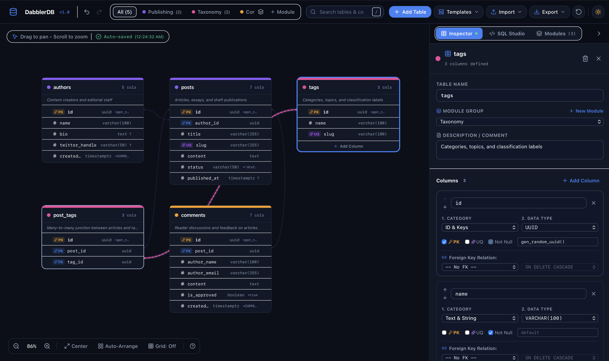
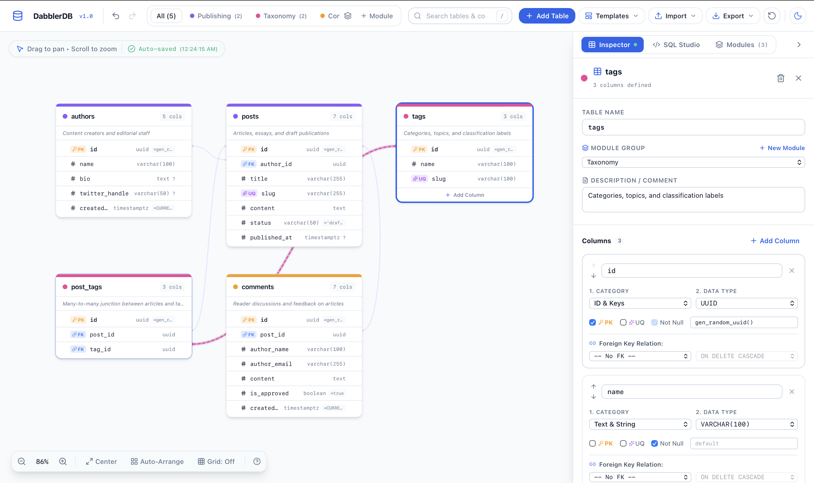

<div align="center">

# ⚡ DabblerDB

**Lightweight, local-first visual database schema designer & bi-directional SQL studio.**

[](https://sakiththewmika.github.io/DabblerDB/)

[](https://github.com/sakiththewmika/DabblerDB/actions/workflows/ci.yml)
[](https://github.com/sakiththewmika/DabblerDB/actions/workflows/deploy.yml)
[](LICENSE)
[](https://www.typescriptlang.org/)
[](https://react.dev/)
[](https://tailwindcss.com/)

[**👉 Try DabblerDB Live in Your Browser (No Sign-Up Required)**](https://sakiththewmika.github.io/DabblerDB/) · [User Guide](docs/USER_GUIDE.md) · [Architecture](docs/ARCHITECTURE.md) · [Report Bug](https://github.com/sakiththewmika/DabblerDB/issues)

</div>

---

## 🖥️ Overview

**DabblerDB** is an open-source, browser-native Entity-Relationship Diagram (ERD) designer and bi-directional SQL studio built for developers, database architects, and students. Design schemas visually on an infinite canvas or write raw DDL in the docked SQL Studio—everything stays 100% on your machine with zero cloud lock-in and instant browser auto-save.

### 🌙 Dark Mode & ☀️ Light Mode
| Dark Theme | Light Theme |
| :---: | :---: |
|  |  |

---

## ✨ Key Features

- ⚡ **100% Local-First & Private**: All tables, relationships, and module groups auto-save directly to your browser's `localStorage` (`dabblerdb_schema_v1`). Your schemas never touch an external server.
- 🎨 **Interactive Infinite Canvas**: Smooth pan and scroll-wheel zoom (`25%` to `180%`) with toggleable background grid cells, semantic zoom readability, `Center View`, and `Auto-Arrange` layout tools.
- 🔗 **Row-Level SVG Foreign Key Edges & Drag-to-Connect**: Precision cubic Bézier curves anchored directly to source `FK` and target `PK` column rows, complete with directional dashed flow animations and drag-to-connect column ports.
- ✏️ **Direct Inline Canvas Editing + Docked Inspector**: Double-click table headers, column names, or data types directly on canvas cards for rapid editing, or use the resizable right-hand Inspector drawer for full constraint configuration (`PK`, `UQ`, `NOT NULL`, `DEFAULT`, `ON DELETE`).
- 💻 **Docked Bi-Directional SQL Studio**: Generate clean, production-ready DDL for **PostgreSQL**, **MySQL 8.0**, and **SQLite 3** with automatic foreign key indexes—or edit/paste SQL scripts and apply them back to the visual canvas in one click.
- 🏷️ **Custom Color-Coded Modules**: Create, rename, color-code, and filter logical domain groups (e.g., *Identity*, *Catalog*, *Sales*).
- 📥 **1-Click Exports (`.sql`, `.svg`, `.json`)**: Export ready-to-run `.sql` scripts, standalone vector `.svg` diagrams for READMEs/documentation, or `.json` workspace backups.
- 🔗 **Zero-Backend Shareable Links & Templates**: Share schemas via URL hash encoding or jumpstart projects with built-in templates (*E-Commerce Store*, *SaaS Multi-Tenant & RBAC*, *Blog & CMS*).
- ⌨️ **Full Undo / Redo & Keyboard Shortcuts**: 50-step history stack with fast hotkeys (`⌘/Ctrl + Z`, `⌘/Ctrl + Shift + Z`, `Shift + N`, `⌘/Ctrl + D`, `Delete`, `?`).
- 🌓 **Dynamic Theme Switching**: Seamless Light Mode and Dark Mode support powered by semantic CSS variables and Tailwind CSS.

---

## ⌨️ Keyboard Shortcuts

| Shortcut | Action |
| :--- | :--- |
| `Cmd / Ctrl + Z` | Undo last schema change |
| `Cmd / Ctrl + Shift + Z` / `Ctrl + Y` | Redo schema change |
| `Shift + N` | Create a new table in viewport center |
| `Cmd / Ctrl + D` | Duplicate selected table |
| `Cmd / Ctrl + K` or `/` | Focus table & column search bar |
| `Delete` / `Backspace` | Delete selected table |
| `Escape` | Deselect current table / close popovers |
| `?` | Open keyboard shortcuts reference |

---

## 🚀 Quick Start (Local Development)

### Prerequisites
- **Node.js** 18+ (Node 20+ recommended)
- **npm** 9+

### Installation & Setup

1. **Clone the repository:**
   ```bash
   git clone https://github.com/sakiththewmika/DabblerDB.git
   cd DabblerDB
   ```

2. **Install dependencies:**
   ```bash
   npm install
   ```

3. **Start the local development server:**
   ```bash
   npm run dev
   ```
   Open [http://localhost:5173](http://localhost:5173) in your browser.

4. **Run unit tests:**
   ```bash
   npm test
   ```

5. **Run linter:**
   ```bash
   npm run lint
   ```

6. **Build for production:**
   ```bash
   npm run build
   ```

---

## 📚 Documentation

- 📖 **[User Guide](docs/USER_GUIDE.md)** — Complete walkthrough on creating tables, linking foreign keys, managing modules, and using the SQL Studio.
- 🏗️ **[Architecture Documentation](docs/ARCHITECTURE.md)** — Deep dive into the Canonical AST state in Zustand, SVG cubic Bézier geometry, and multi-dialect SQL compilation.
- 🤝 **[Contributing Guidelines](CONTRIBUTING.md)** — Branching workflow, Conventional Commits standard, and Pull Request checklist.
- 📜 **[Code of Conduct](CODE_OF_CONDUCT.md)** — Contributor Covenant community standards.

---

## 🛠️ Tech Stack

- **Frontend**: [React 19](https://react.dev/) + [TypeScript 5](https://www.typescriptlang.org/)
- **Bundler**: [Vite 8](https://vite.dev/)
- **Styling**: [Tailwind CSS 3.4](https://tailwindcss.com/) (Dark/Light semantic themes)
- **State & History**: [Zustand 5](https://github.com/pmndrs/zustand) (`persist` middleware + snapshot history)
- **Icons**: [Lucide React](https://lucide.dev/)
- **Testing**: [Vitest](https://vitest.dev/)
- **CI/CD**: GitHub Actions + GitHub Pages

---

## 📄 License

Distributed under the [MIT License](LICENSE). Copyright © 2026 [Sakith Thewmika](https://github.com/sakiththewmika).